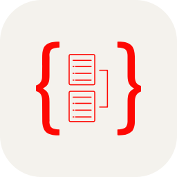

<!--
  GitHub profile README.
  Blocks between `content:*:start/end` markers are generated from packages/content — edit the
  YAML there and run `pnpm readme`. Everything else in this file is hand-written.
-->

<!-- ───────────── Header ───────────── -->

<!-- content:header:start -->

  

<!-- content:header:end -->

  
  

<!-- content:motto:start -->

<i>“Coding the future, one commit at a time!”</i>

<!-- content:motto:end -->

---

<!-- ───────────── About ───────────── -->

### 👋 A little about me

<table>
  <tr>
    <td width="64%" valign="top">

Hey there! I'm **Biprodas Roy**, a Software Engineer and Full Stack Developer based in **Bangladesh** 🇧🇩.

For **8+ years** I've been building SaaS, ERP, FinTech and real-time AI platforms — from the first database schema to production. Most recently, I've worked remotely with teams in **South Korea** 🇰🇷 and **Australia** 🇦🇺.

Today I'm going deeper into **AI** — LLM-powered systems, RAG and agentic workflows — and exploring research directions for graduate study.

**What I bring:**

- Turning complex problems into clean, reliable software
- Working closely with teams and clients to ship products people rely on
- Building sustainable tech with real-world impact
- Always learning, and passing it on through mentoring

</td>
    <td width="36%" align="center" valign="middle">
      
        
      <code>Software Engineer</code> · <code>AI Researcher</code>
        
       
      
      
      <!-- Add once live:
      
      -->
    </td>
  </tr>
</table>

### 🛠️ Tech stack

<!-- content:stack:start -->
<table>
  <tr>
    <td><b>Languages</b></td>
    <td width="100%"><picture><source media="(prefers-color-scheme: dark)" srcset="https://skillicons.dev/icons?i=ts&theme=dark" /></picture>&nbsp;&nbsp;<picture><source media="(prefers-color-scheme: dark)" srcset="https://skillicons.dev/icons?i=js&theme=dark" /></picture>&nbsp;&nbsp;<picture><source media="(prefers-color-scheme: dark)" srcset="https://skillicons.dev/icons?i=py&theme=dark" /></picture>&nbsp;&nbsp;<picture><source media="(prefers-color-scheme: dark)" srcset="https://skillicons.dev/icons?i=java&theme=dark" /></picture>&nbsp;&nbsp;<picture><source media="(prefers-color-scheme: dark)" srcset="https://skillicons.dev/icons?i=cpp&theme=dark" /></picture></td>
  </tr>
  <tr>
    <td><b>Frontend</b></td>
    <td width="100%"><picture><source media="(prefers-color-scheme: dark)" srcset="https://skillicons.dev/icons?i=react&theme=dark" /></picture>&nbsp;&nbsp;<picture><source media="(prefers-color-scheme: dark)" srcset="https://skillicons.dev/icons?i=nextjs&theme=dark" /></picture>&nbsp;&nbsp;<picture><source media="(prefers-color-scheme: dark)" srcset="https://skillicons.dev/icons?i=tailwind&theme=dark" /></picture>&nbsp;&nbsp;<picture><source media="(prefers-color-scheme: dark)" srcset="packages/readme/assets/icons/reactquery-dark.svg" /></picture>&nbsp;&nbsp;<picture><source media="(prefers-color-scheme: dark)" srcset="https://skillicons.dev/icons?i=redux&theme=dark" /></picture>&nbsp;&nbsp;<picture><source media="(prefers-color-scheme: dark)" srcset="packages/readme/assets/icons/shadcnui-dark.svg" /></picture></td>
  </tr>
  <tr>
    <td><b>Backend&nbsp;&amp;&nbsp;Architecture</b></td>
    <td width="100%"><picture><source media="(prefers-color-scheme: dark)" srcset="https://skillicons.dev/icons?i=nodejs&theme=dark" /></picture>&nbsp;&nbsp;<picture><source media="(prefers-color-scheme: dark)" srcset="https://skillicons.dev/icons?i=nestjs&theme=dark" /></picture>&nbsp;&nbsp;<picture><source media="(prefers-color-scheme: dark)" srcset="https://skillicons.dev/icons?i=express&theme=dark" /></picture>&nbsp;&nbsp;<picture><source media="(prefers-color-scheme: dark)" srcset="https://skillicons.dev/icons?i=fastapi&theme=dark" /></picture>&nbsp;&nbsp;<picture><source media="(prefers-color-scheme: dark)" srcset="https://skillicons.dev/icons?i=graphql&theme=dark" /></picture></td>
  </tr>
  <tr>
    <td><b>Data&nbsp;&amp;&nbsp;Messaging</b></td>
    <td width="100%"><picture><source media="(prefers-color-scheme: dark)" srcset="https://skillicons.dev/icons?i=postgres&theme=dark" /></picture>&nbsp;&nbsp;<picture><source media="(prefers-color-scheme: dark)" srcset="https://skillicons.dev/icons?i=redis&theme=dark" /></picture>&nbsp;&nbsp;<picture><source media="(prefers-color-scheme: dark)" srcset="https://skillicons.dev/icons?i=mongodb&theme=dark" /></picture>&nbsp;&nbsp;<picture><source media="(prefers-color-scheme: dark)" srcset="https://skillicons.dev/icons?i=mysql&theme=dark" /></picture>&nbsp;&nbsp;<picture><source media="(prefers-color-scheme: dark)" srcset="https://skillicons.dev/icons?i=dynamodb&theme=dark" /></picture>&nbsp;&nbsp;<picture><source media="(prefers-color-scheme: dark)" srcset="packages/readme/assets/icons/typeorm-dark.svg" /></picture>&nbsp;&nbsp;<picture><source media="(prefers-color-scheme: dark)" srcset="https://skillicons.dev/icons?i=prisma&theme=dark" /></picture></td>
  </tr>
  <tr>
    <td><b>Cloud&nbsp;&amp;&nbsp;DevOps</b></td>
    <td width="100%"><picture><source media="(prefers-color-scheme: dark)" srcset="https://skillicons.dev/icons?i=aws&theme=dark" /></picture>&nbsp;&nbsp;<picture><source media="(prefers-color-scheme: dark)" srcset="https://skillicons.dev/icons?i=docker&theme=dark" /></picture>&nbsp;&nbsp;<picture><source media="(prefers-color-scheme: dark)" srcset="https://skillicons.dev/icons?i=githubactions&theme=dark" /></picture>&nbsp;&nbsp;<picture><source media="(prefers-color-scheme: dark)" srcset="https://skillicons.dev/icons?i=nginx&theme=dark" /></picture>&nbsp;&nbsp;<picture><source media="(prefers-color-scheme: dark)" srcset="https://skillicons.dev/icons?i=vercel&theme=dark" /></picture></td>
  </tr>
  <tr>
    <td><b>Tools</b></td>
    <td width="100%"><picture><source media="(prefers-color-scheme: dark)" srcset="https://skillicons.dev/icons?i=linux&theme=dark" /></picture>&nbsp;&nbsp;<picture><source media="(prefers-color-scheme: dark)" srcset="https://skillicons.dev/icons?i=vscode&theme=dark" /></picture>&nbsp;&nbsp;<picture><source media="(prefers-color-scheme: dark)" srcset="https://skillicons.dev/icons?i=git&theme=dark" /></picture>&nbsp;&nbsp;<picture><source media="(prefers-color-scheme: dark)" srcset="https://skillicons.dev/icons?i=github&theme=dark" /></picture></td>
  </tr>
</table>
<!-- content:stack:end -->

### 🚀 Featured works

<!-- content:projects:start -->
<table>
<tr>
<td width="50%" valign="top">

#### PitchPool

SaaS · Multi-tenancy · Billing

Multi-tenant SaaS platform for competition prediction pools with automated scoring, live leaderboards, and subscription billing.

`Next.js` `React` `TypeScript` `NestJS` `PostgreSQL` `Prisma`

</td>
<td width="50%" valign="top">

#### Microfinance Core Banking System

FinTech · Microfinance · Accounting

Multi-tenant core banking platform for NGO microfinance operations, deployed across 3 organizations and 20 branches.

`Next.js` `NestJS` `PostgreSQL` `Redis` `BullMQ` `TypeORM`

</td>
</tr>
<tr>
<td width="50%" valign="top">

#### StartDescribe

AI · SaaS · E-commerce

AI SaaS platform for e-commerce product descriptions and image generation, with multi-tenant architecture and Stripe-based subscriptions.

`Next.js` `TypeScript` `Tailwind` `Supabase` `Stripe` `OpenAI`

</td>
<td width="50%" valign="top">

#### Akaunty

FinTech · Accounting · SaaS

Multi-tenant SaaS that gives freelancers, agencies, NGOs and small businesses simple financial tracking, with proper double-entry accounting underneath.

`Next.js` `NestJS` `PostgreSQL` `Drizzle` `Redis` `BullMQ`

</td>
</tr>
<tr>
<td width="50%" valign="top">

#### School ERP

EdTech · ERP · Multi-tenancy

School administration platform covering admissions, academics, students, parents and staff, finance, campus services, communication and reporting.

`Next.js` `React` `NestJS` `PostgreSQL` `TypeORM` `Redis`

</td>
<td width="50%" valign="top">

#### Cloud Prep

EdTech · AWS · Certification Prep

Practice app for AWS certification exams — questions organized by certification and AWS service, with an explanation on every answer and per-topic accuracy tracking.

`Next.js` `TypeScript` `Supabase` `TanStack Query` `Tailwind CSS` `Paddle`

</td>
</tr>
</table>
<!-- content:projects:end -->

<a href="https://github.com/biprodas?tab=repositories">See more on GitHub →</a>

### 📜 Certifications

<!-- content:certifications:start -->
- <picture><source media="(prefers-color-scheme: dark)" srcset="https://skillicons.dev/icons?i=aws&theme=dark" /></picture>&nbsp; **[AWS Certified Developer – Associate](https://www.credly.com/badges/4d0c8176-caa8-426d-a585-db032b996210)** · Amazon Web Services
- <picture><source media="(prefers-color-scheme: dark)" srcset="https://skillicons.dev/icons?i=aws&theme=dark" /></picture>&nbsp; **[AWS Certified Solutions Architect – Associate](https://www.credly.com/badges/8cd1fa7d-ed80-492e-bbf5-cfe8d4011129)** · Amazon Web Services
- <picture><source media="(prefers-color-scheme: dark)" srcset="https://skillicons.dev/icons?i=aws&theme=dark" /></picture>&nbsp; **[AWS Certified AI Practitioner](https://www.credly.com/badges/e329c8fb-2511-4c1f-b00c-6f336863b4f4)** · Amazon Web Services
- <picture><source media="(prefers-color-scheme: dark)" srcset="https://skillicons.dev/icons?i=aws&theme=dark" /></picture>&nbsp; **[AWS Certified Cloud Practitioner](https://www.credly.com/badges/d26478be-16ba-423e-8d9d-981039016e08)** · Amazon Web Services
- <picture><source media="(prefers-color-scheme: dark)" srcset="packages/readme/assets/icons/hackerrank-dark.svg" /></picture>&nbsp; **[SQL (Intermediate)](https://www.hackerrank.com/skills-verification/sql_intermediate)** · HackerRank
- <picture><source media="(prefers-color-scheme: dark)" srcset="packages/readme/assets/icons/hackerrank-dark.svg" /></picture>&nbsp; **[Problem Solving (Intermediate)](https://www.hackerrank.com/skills-verification/problem_solving_intermediate)** · HackerRank
<!-- content:certifications:end -->

### 🌱 Right now

- 🔭 **Exploring:** LLM & agentic systems, SaaS architecture, graduate research directions
- 🌱 **Getting better at:** mentoring, leading teams, product thinking
- 💬 **Let's talk about:** SaaS, system design, startups, science & technology, football

<!-- content:footer:start -->

  

<!-- content:footer:end -->
